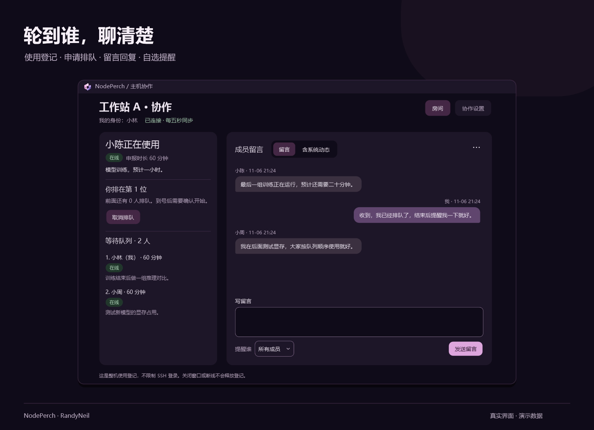

<h2 align="center">
  <a href="https://github.com/NeilRandy/NodePerch/releases/download/v0.5.0-preview.14/NodePerch-0.5.0-preview.14-win-x64.zip">⬇ 下载 Windows 版 · 协作预览版</a>
</h2>

  v0.5.0-preview.14 · Windows x64 · 非商业许可 
  <a href="#安装与连接">安装与连接</a> ·
  <a href="使用说明.md">使用说明</a> ·
  <a href="协作使用指南.md">协作指南</a> ·
  <a href="https://github.com/NeilRandy/NodePerch/releases">全部版本</a>

图片来自当前版本的真实界面，主机、成员及性能数值均为演示数据。历史曲线保存在本次运行的内存中，退出后清空。

## 安装与连接

1. **下载并完整解压** [Windows 运行包](https://github.com/NeilRandy/NodePerch/releases/download/v0.5.0-preview.14/NodePerch-0.5.0-preview.14-win-x64.zip)，双击 `NodePerch.exe`。
2. **添加主机**：选择 SSH 别名，或填写地址、用户名、端口和私钥路径。
3. **检查登录**：首次连接可点“检查 SSH 登录”，核实主机指纹并完成登录，输入 `exit` 返回看板。
4. **开始查看**：点击“添加并连接”。持续采集需要密钥或 SSH agent 免交互登录。

> 更新前请先从托盘退出旧版，否则会唤回旧窗口。GitHub 自动生成的 **Source code** 和 **Code → Download ZIP** 只有本仓库的介绍资料，不能运行程序。下载校验见 [SHA-256 文件](https://github.com/NeilRandy/NodePerch/releases/download/v0.5.0-preview.14/NodePerch-0.5.0-preview.14-win-x64.zip.sha256)。

| 位置 | 要求 |
| --- | --- |
| 本机 | 64 位 Windows、.NET Framework 4.8、OpenSSH 客户端 |
| Linux 主机 | SSH 服务、登录权限、`/usr/bin/python3` |
| Windows 主机 | SSH 服务、登录权限、PowerShell 5.1 |
| NVIDIA GPU 指标 | 远端可执行 `nvidia-smi`；没有支持的显卡仍可查看 CPU 和内存 |

本机无需 Python，远端无需常驻监控服务。软件不保存密码或私钥内容，不修改 SSH 配置。

## 开始协作

连接主机后，点击“协作排队” → 保存昵称 → 启用此主机协作，即可申请排队或留言。默认自动准备共享目录，不同 SSH 账号可能需要管理员配置目录权限；托盘提醒由本人选择开启，默认关闭。

这是整机使用登记与协调功能，不会限制他人登录或运行任务。留言对房间成员可见，指定成员只决定提醒对象。昵称尚不具备严格身份认证，适合相互信任的团队。[查看协作规则与权限说明 →](协作使用指南.md)

## 日常使用与反馈

- 点“×”收起到托盘并继续采样；托盘菜单中的“退出”才会彻底关闭。
- 原有主机与主题设置可沿用；暂停、编辑连接、进程筛选和留言清理见[使用说明](使用说明.md)。
- 本仓库只提供下载入口、介绍图片和用户文档，不公开项目源码。
- 遇到问题可[提交 Issue](https://github.com/NeilRandy/NodePerch/issues)，附版本、远端系统、操作步骤和错误文字。请勿上传密码、私钥或个人 SSH 配置，截图请遮盖私人信息。

本次新增功能与修复见[版本记录](CHANGELOG.md)。

## 署名与许可

Copyright © 2026 **RandyNeil**。

NodePerch 采用**非商业许可**。个人学习、非商业教学与科研可免费使用；免费转发完整原版时须保留署名和许可。商业使用、商业集成、收费部署，以及向本人或所在课题组以外分发修改版，需要作者另行书面授权。

具体以 [LICENSE.txt](LICENSE.txt) 为准。如需讨论授权，可先在仓库提出请求；公开留言本身不代表已获得授权。
