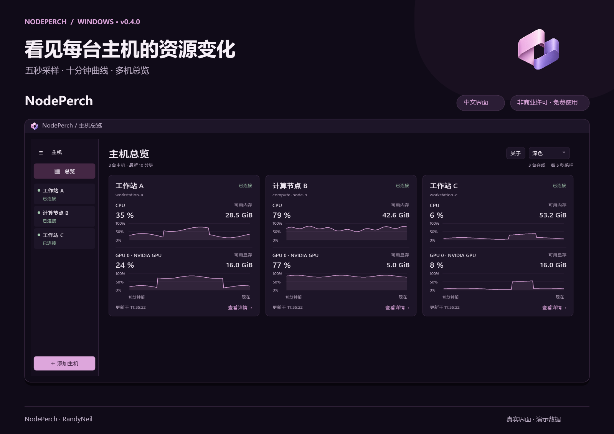
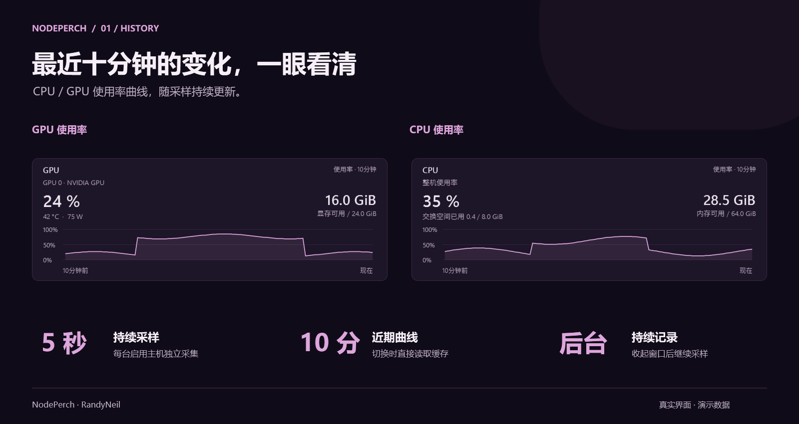

# NodePerch

中文 Windows 多机资源看板，查看 CPU／GPU 最近十分钟的变化。

## [⬇ 下载 Windows 版 · v0.4.0](https://github.com/NeilRandy/NodePerch/releases/download/v0.4.0/NodePerch-0.4.0-win-x64.zip)

**下载 ZIP → 完整解压 → 双击 `NodePerch.exe`。** 当前为公开预览版，适用于 64 位 Windows。

[使用说明](使用说明.md) · [全部版本](https://github.com/NeilRandy/NodePerch/releases) · [SHA-256 校验文件](https://github.com/NeilRandy/NodePerch/releases/download/v0.4.0/NodePerch-0.4.0-win-x64.zip.sha256) · [反馈问题](https://github.com/NeilRandy/NodePerch/issues)

> **想直接使用，请下载上面的 Windows 运行包。** GitHub 的绿色 Code → Download ZIP，以及 Releases 自动生成的 Source code，仅打包本仓库的说明和图片，不能运行程序。

NodePerch 通过 SSH 查看多台 Linux／Windows 主机的 CPU、GPU、可用内存、显存和进程，适合需要经常查看计算节点、实验室工作站运行情况的个人、同学和课题组。

**作者：RandyNeil · 非商业许可**。个人学习、非商业教学与科研可免费使用，具体范围见 [LICENSE.txt](LICENSE.txt)。本仓库提供程序下载、使用说明和问题反馈。

## 不只看此刻，也看最近的变化

每台启用主机默认 **五秒采样**，后台保留最近 **十分钟 CPU／GPU 使用率曲线**。任务刚刚结束、负载突然升高，或 GPU 一直没有忙起来，都能结合曲线查看。切换主机直接读取已有缓存，不用重新等待曲线积累。

曲线保存在本次运行的内存中，退出程序后清空；当前版本不提供长期历史存储。

## 多台主机，一屏查看

每台主机一张卡片，集中显示 CPU、各 GPU 的使用率曲线、可用内存和显存。点击卡片进入详细页，继续查看进程、磁盘和网络信息。总览与详情复用同一份数据，切换页面不会中断其他主机采集，也不会增加重复连接。

## 添加一次，下次自动连接

已有 SSH 配置可以直接选择；也可以手动填写地址、用户名、端口和私钥路径。新增主机默认启用，以后启动自动连接。右键主机即可暂停、启用、编辑或移除；离线后自动逐步延长重试间隔。

以上配图使用真实 WPF 控件和虚构演示数据，不代表特定硬件的性能测试结果。

## 日常使用更顺手

- **收起到托盘**：点“×”后继续后台采样，隐藏时停止界面刷新。托盘可打开看板或彻底退出，重复启动会唤回已有窗口。
- **快速找到活跃进程**：CPU 进程支持“活跃／全部”切换，按内存排序时显示全部；筛选只影响界面。
- **查看 GPU 进程**：支持显卡和计算／图形类型筛选，Windows 进程显存缺失时尝试补读系统统计；无法读取的值显示“—”。
- **清楚的主机状态**：在线绿色、离线红色、暂停橙色，侧栏折叠后仍可辨认。
- **保留熟悉的桌面体验**：中文界面，浅色、深色和跟随系统主题；解压后直接运行。

## 快速开始

1. 下载 [NodePerch-0.4.0-win-x64.zip](https://github.com/NeilRandy/NodePerch/releases/download/v0.4.0/NodePerch-0.4.0-win-x64.zip)，完整解压后双击 `NodePerch.exe`。不要只复制 EXE。
2. 点击“添加第一台主机”，选择 SSH 别名或手动填写连接信息。
3. 首次连接可点“检查 SSH 登录”，在终端核实主机指纹并检查登录，完成后输入 `exit`。
4. 点击“添加并连接”，收到数据后即可在总览中查看。后台采集需要 **密钥或 SSH agent 免交互登录**；仅能手动输入密码的连接尚不能用于持续采集。

| 位置 | 需要什么 |
| --- | --- |
| 本机客户端 | 64 位 Windows、.NET Framework 4.8、OpenSSH 客户端 |
| Linux 主机 | SSH 服务、登录权限、`/usr/bin/python3` |
| Windows 主机 | SSH 服务、登录权限、PowerShell 5.1 |
| NVIDIA GPU 指标 | 远端可执行 `nvidia-smi`；没有 NVIDIA 显卡仍可查看 CPU、内存等指标 |

本机看板已编译为 C#／WPF，不需要安装本机 Python 或额外加载 PowerShell 引擎。远端采集脚本随运行库内嵌，通过 SSH 执行，不需要安装常驻监控服务。程序不保存密码或私钥内容，也不修改 SSH 配置。

更新前请从托盘退出旧版，再打开新版。主机、启用状态和主题保存在 `%LOCALAPPDATA%\SharedResourceDashboard\settings.json`，不会随分享包转发。更多操作和指标说明见[使用说明](使用说明.md)。

## 反馈与版本记录

遇到问题或有功能建议，可以[提交 Issue](https://github.com/NeilRandy/NodePerch/issues)。请附软件版本、远端系统、操作步骤和错误文字；截图请遮盖不希望公开的主机信息，不要上传密码、私钥或个人 SSH 配置。

查看[版本记录](CHANGELOG.md)，了解已发布功能。

## 署名与许可

Copyright © 2026 **RandyNeil**。

NodePerch 采用**非商业许可**。个人学习、非商业教学与科研可免费使用；免费转发完整原版时须保留署名和许可。商业使用、商业集成、收费部署，以及向本人或所在课题组以外分发修改版，需要作者另行书面授权。

使用范围以发行包内的 [LICENSE.txt](LICENSE.txt) 为准。如需讨论授权，可先在仓库提出请求；公开留言本身不代表已获得授权。
